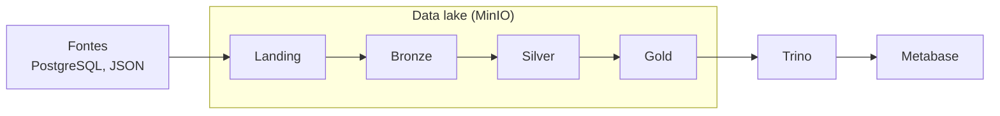
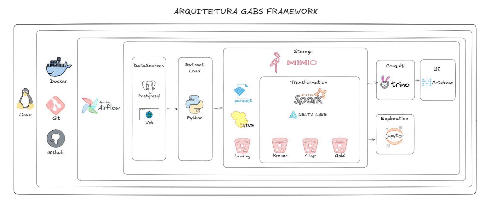

# Gabs Data Framework

Framework de dados open source para construir e operar pipelines em uma arquitetura *lakehouse*, montado do zero para estudo e evolução contínua.

O repositório reúne duas coisas:

- **A plataforma**: a infraestrutura e os serviços (armazenamento, processamento, catálogo, orquestração), definidos como código.
- **A biblioteca `gabs`**: funções Python compartilhadas por todos os pipelines, para que cada um se preocupe só com a própria regra de negócio.

Os pipelines de cada produto ficam em repositórios próprios, clonados dentro da pasta `dags/`.

## Objetivo

Criar uma arquitetura moderna de pipelines de dados:

- armazenamento separado do processamento;
- dados organizados em camadas (arquitetura medalhão);
- tabelas com transações, histórico e *time travel*;
- infraestrutura reproduzível, versionada no Git;
- código de pipeline que não depende de onde roda (máquina local, VM ou cluster).

## Arquitetura





O Spark, com Delta Lake, faz as transformações entre as camadas. O Airflow orquestra a execução, o Hive Metastore registra as tabelas e o OpenMetadata documenta o que existe e de onde veio.

### Camadas

Cada camada é um bucket, organizado como `s3a://<camada>/<produto>/<tabela>`.

| Camada | Conteúdo |
|---|---|
| `landing` | Arquivo como veio da fonte (JSON, CSV), sem alteração |
| `bronze` | O mesmo dado em tabela Delta, sem regra de negócio |
| `silver` | Limpo, tipado, padronizado e sem duplicatas |
| `gold` | Agregado e modelado para consumo |

## Tecnologias

| Ferramenta | Papel | Situação |
|---|---|---|
| Docker e Docker Compose | Execução de todos os serviços em contêineres | Em uso |
| MinIO (fork Silo) | Data lake, com API compatível com S3 | Em uso |
| Apache Spark 3.5 (PySpark) | Processamento e transformação | Em uso |
| Delta Lake 3.3 | Formato de tabela: ACID, histórico e *time travel* | Em uso |
| JupyterLab | Exploração e prototipação | Em uso |
| Terraform | Infraestrutura como código | Código pronto |
| Google Cloud (Compute Engine) | Máquina virtual que hospeda a plataforma | Código pronto |
| PostgreSQL | Fonte de dados e banco interno de Metastore, Airflow e Metabase | Código pronto |
| Hive Metastore 3.1 | Catálogo de tabelas compartilhado entre Spark e Trino | Código pronto |
| Trino | Motor de consulta SQL sobre o lake | Código pronto |
| Apache Airflow 3 | Orquestração dos pipelines | Código pronto |
| Metabase | Visualização | Código pronto |
| OpenMetadata | Catálogo, linhagem e qualidade de dados | Planejada |

O MinIO comunitário foi descontinuado e teve as imagens oficiais retiradas do Docker Hub. Por isso o projeto usa o [Silo](https://github.com/pgsty/silo), um fork mantido que preserva a mesma API e as mesmas variáveis.

## Fases

| Fase | Entrega | Situação |
|---|---|---|
| 0 | Infraestrutura no GCP com Terraform: rede, firewall, VM, disco de dados e desligamento automático | Código pronto, VM ainda não criada |
| 1 | Núcleo do lakehouse: MinIO, Spark, Delta Lake e Jupyter | Concluída |
| 2 | Catálogo: PostgreSQL e Hive Metastore | Código pronto |
| 3 | Camada SQL: Trino consultando as tabelas Delta | Código pronto |
| 4 | Orquestração: Airflow rodando o pipeline da Landing à Gold | Código pronto |
| 5 | Visualização: Metabase conectado ao Trino | Código pronto |
| 6 | Governança: OpenMetadata com linhagem e qualidade | Planejada |
| 7 | Extras: proxy com HTTPS, documentação com MkDocs, storage nativo da nuvem, cluster Spark | Planejada |

Cada fase entrega algo funcionando antes de a próxima começar.

## Estrutura do repositório

```
gabs_dataframework/
├── dags/                    # um repositório por produto, clonado aqui
│   └── vendas/              # produto de exemplo (repositório próprio)
├── docker/
│   ├── docker-compose.yml   # serviços da plataforma, agrupados em profiles
│   ├── airflow/Dockerfile   # Airflow 3 com Spark, Delta e conectores
│   ├── hive/                # Hive Metastore: imagem, configuração e inicialização
│   ├── jupyter/Dockerfile   # JupyterLab com Spark, Delta e conectores
│   ├── postgres/init.sql    # bancos internos e dados de origem de exemplo
│   └── trino/               # memória do Trino e catálogo "delta"
├── gabs/                    # biblioteca compartilhada
│   ├── spark.py             # sessão Spark configurada (Delta, MinIO, Metastore)
│   ├── storage.py           # caminhos das camadas
│   └── tables.py            # gravar e ler tabelas registradas no catálogo
├── infra/terraform/         # infraestrutura no GCP
├── notebooks/               # notebooks de exploração e validação
└── .env.example             # modelo das variáveis de ambiente
```

### Convenção de tabelas

| Camada | Schema no catálogo | Nome da tabela | Arquivos |
|---|---|---|---|
| landing | não tem (só arquivos) | | `s3a://landing/<produto>/<tabela>/dt_carga=AAAA-MM-DD/` |
| bronze, silver, gold | `bronze`, `silver`, `gold` | `<produto>_<tabela>` | `s3a://<camada>/<produto>/<tabela>` |

A mesma tabela é encontrada pelo nome em qualquer ferramenta: `spark.read.table("gold.vendas_resumo_diario")` no Spark, `SELECT * FROM delta.gold.vendas_resumo_diario` no Trino.

## Como executar

A plataforma foi dimensionada para rodar numa máquina de **8 GB de RAM**. Para isso, os serviços são agrupados em *profiles* do Docker Compose: a base sobe sempre, e o resto entra conforme o que se vai estudar.

| Profile | Serviços | Memória aproximada |
|---|---|---|
| base (sempre) | MinIO, PostgreSQL, Hive Metastore | 1,5 GB |
| `pipeline` | Airflow, com os jobs Spark dentro dele | + 3 GB |
| `sql` | Trino | + 1,7 GB |
| `bi` | Trino e Metabase | + 2,9 GB |
| `lab` | JupyterLab com Spark | + 2 GB |

Os dados ficam no MinIO e o catálogo no PostgreSQL, então nada se perde ao trocar de profile.

### 1. Preparar a máquina (Ubuntu Server)

Instale o Docker e libere o seu usuário para usá-lo:

```bash
curl -fsSL https://get.docker.com | sudo sh
sudo usermod -aG docker $USER      # saia e entre de novo na sessão
```

Confira se há swap; ela evita que um pico de memória derrube um contêiner:

```bash
swapon --show
```

Se não aparecer nada, crie 4 GB:

```bash
sudo fallocate -l 4G /swapfile && sudo chmod 600 /swapfile
sudo mkswap /swapfile && sudo swapon /swapfile
echo '/swapfile none swap sw 0 0' | sudo tee -a /etc/fstab
```

Reserve uns 30 GB livres em disco para as imagens.

### 2. Clonar e configurar

```bash
git clone https://github.com/sanchesfranklin/gabs_dataframework.git
cd gabs_dataframework
cp .env.example .env
```

Preencha o `.env`. Para gerar cada senha e segredo:

```bash
openssl rand -hex 16
```

Se for abrir as telas de outro computador da rede, use `BIND_ADDR=0.0.0.0`.

Clone o produto de exemplo dentro de `dags/`:

```bash
git clone <url-do-repositorio-do-produto-vendas> dags/vendas
```

### 3. Subir

Para facilitar, crie um atalho para o comando longo (vale até fechar o terminal):

```bash
alias dc='docker compose -f docker/docker-compose.yml --env-file .env'
```

Suba o modo desejado. A primeira vez constrói as imagens e pode levar de 20 a 40 minutos num HD:

```bash
dc --profile pipeline up -d --build     # base + Airflow
dc --profile bi up -d                    # base + Trino + Metabase
dc --profile lab up -d --build           # base + Jupyter
```

Para ver o estado e parar:

```bash
dc --profile "*" ps -a
dc --profile pipeline stop airflow       # para só o Airflow
dc --profile "*" down                    # para tudo (os dados são preservados)
```

| Contêiner | Estado esperado |
|---|---|
| `gabs-minio`, `gabs-postgres`, `gabs-hive-metastore` | `Up (healthy)` |
| `gabs-minio-init` | `Exited (0)`, pois só cria os buckets e termina |
| `gabs-airflow`, `gabs-trino`, `gabs-metabase`, `gabs-jupyter` | `Up`, conforme o profile |

O Hive Metastore demora alguns minutos para ficar `healthy` na primeira vez, porque cria o próprio schema no PostgreSQL.

### 4. Acessar

Troque `localhost` pelo IP do servidor se estiver usando `BIND_ADDR=0.0.0.0`.

| Serviço | Endereço | Acesso |
|---|---|---|
| Console do MinIO | http://localhost:9001 | `MINIO_ROOT_USER` e `MINIO_ROOT_PASSWORD` |
| Airflow | http://localhost:8080 | usuário `admin`; senha com o comando abaixo |
| Trino | http://localhost:8085 | interface de acompanhamento de consultas; qualquer usuário |
| Metabase | http://localhost:3000 | cria-se o administrador no primeiro acesso |
| JupyterLab | http://localhost:8888 | `JUPYTER_TOKEN` |
| PostgreSQL | localhost:5432 | `POSTGRES_USER` e `POSTGRES_PASSWORD` |

Senha do Airflow, gerada na primeira subida:

```bash
docker exec gabs-airflow cat /opt/airflow/simple_auth_manager_passwords.json.generated
```

### 5. Rodar o pipeline de ponta a ponta

1. Com o profile `pipeline`, abra o Airflow, ative a DAG `vendas_pedidos` e dispare uma execução.
2. As quatro tarefas rodam em sequência: `landing`, `bronze`, `silver` e `gold`.
3. No console do MinIO, os buckets passam a ter os arquivos de cada camada.

Depois, com o profile `sql` ou `bi`, consulte pelo Trino:

```bash
docker exec -it gabs-trino trino
```

```sql
SHOW SCHEMAS FROM delta;
SHOW TABLES FROM delta.gold;
SELECT * FROM delta.gold.vendas_resumo_diario ORDER BY DT_PEDIDO, SG_UF LIMIT 10;
```

### 6. Conectar o Metabase ao Trino

Em **Admin → Databases → Add a database**, escolha **Starburst** (o mesmo driver serve para Trino) e preencha:

| Campo | Valor |
|---|---|
| Host | `trino` |
| Port | `8080` |
| Catalog | `delta` |
| Username | `metabase` (qualquer nome; o Trino local não exige senha) |

O host e a porta são os da rede interna do Docker, não os do seu navegador.

### Problemas comuns

- **`gabs-minio-init` com `Exited (1)` e erro de *timeout***: a rede entre os contêineres não respondeu. Rode `dc --profile "*" down` e suba de novo.
- **Erro de variável obrigatória ao subir**: falta preencher algum campo do `.env`.
- **Contêiner reiniciando sozinho**: provavelmente faltou memória. Veja com `docker stats` e suba menos profiles ao mesmo tempo.
- **Tabela não aparece no Trino**: registre-a pelo caminho:
  `CALL delta.system.register_table(schema_name => 'gold', table_name => 'vendas_resumo_diario', table_location => 's3a://gold/vendas/resumo_diario')`
- **O `init.sql` não rodou**: ele só roda com o volume do PostgreSQL vazio. Para recomeçar do zero (apaga todos os dados): `dc --profile "*" down -v`.

## Usando a biblioteca

```python
from gabs import tables
from gabs.spark import get_spark_session

spark = get_spark_session("meu_pipeline")

pedidos = tables.read_table(spark, "silver", "vendas", "pedidos")     # silver.vendas_pedidos
tables.write_table(pedidos, "gold", "vendas", "pedidos_copia")         # grava em Delta e registra
```

O endereço do storage, as credenciais e o endereço do Metastore vêm de variáveis de ambiente, definidas no `docker-compose.yml`.

## Infraestrutura no GCP

A pasta `infra/terraform` cria a rede, o firewall restrito, a VM com Docker e um disco de dados separado, com desligamento automático diário. Copie `terraform.tfvars.example` para `terraform.tfvars`, preencha o ID do projeto e o seu IP, e rode `terraform init`, `plan` e `apply`.

---

© 2026 Sanches Franklin. Todos os direitos reservados.
Projeto de estudo. O código está disponível para consulta, sem licença de uso.
